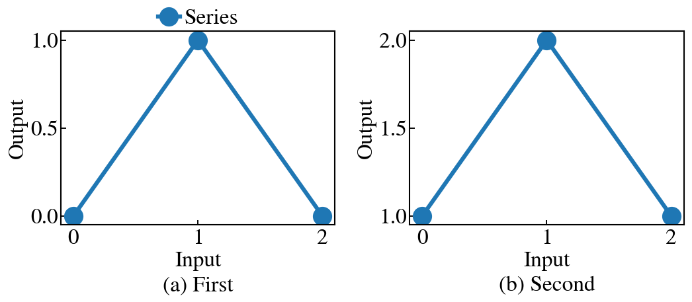

# Minimal example

This data-free example shows the complete `paperfig` call order for a two-panel, single-column figure.

From the repository root, install the package and run:

```bash
python -m pip install -e .
python examples/minimal/plot.py
```

The output is `examples/minimal/minimal.png`. Its width is fixed to the default paper column width at 300 dpi, and unused vertical canvas space is cropped.


